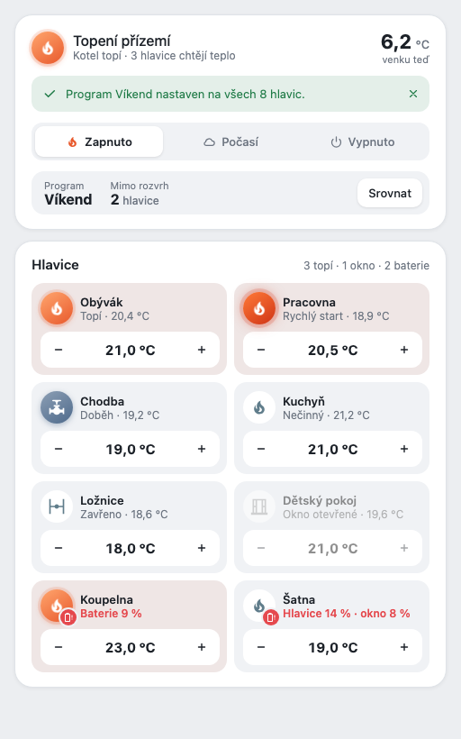

[English](README.md) · **Čeština**

# Heating Card

Karta pro Home Assistant, která zobrazuje jeden topný okruh v stylu Homecraft: box okruhu (kruh s plamenem, venkovní teplota, stavová zpráva, režim, program a hlavice mimo rozvrh) a box hlavic (dlaždice s fází, stavem a − cílová teplota +). Je to rozhraní tématu `homecraft` pro topení v [ha-features-builder](https://github.com/eMalinos/ha-features-builder) a čte jen entity, které feature `heating` zveřejňuje.



## Instalace

**HACS (vlastní repozitář):** HACS → ⋮ → Vlastní repozitáře → `https://github.com/eMalinos/heating-card`, typ **Dashboard** → stáhnout **Heating Card** → obnovit prohlížeč.

**Ručně:** zkopíruj [`dist/heating-card.js`](dist/heating-card.js) do `config/www/` a přidej ho jako zdroj dashboardu (Nastavení → Dashboardy → ⋮ → Zdroje → URL `/local/heating-card.js?v=0.1.0`, typ **JavaScript module**). Po zkopírování nové verze změň `?v=`.

## Konfigurace

Konfiguraci zapisuje feature `heating` z ha-features-builder. Ručně:

```yaml
type: custom:heating-card
circuit: heating_circuit_1        # id instance topení
valves:                            # hlavice okruhu
  - climate.living_room_valve
  - climate.bedroom_valve
heading: Topení přízemí            # volitelné; výchozí: atribut title u binary_sensor.heating_state_<okruh>, jinak id
schedule_gesture: tap              # otevře kartu rozvrhu pro hlavici
info_gesture: icon_tap             # otevře more-info hlavice
```

Gesta: `tap`, `double_tap`, `hold`, `icon_tap`, `icon_double_tap`, `icon_hold` nebo `none` (stejné hodnoty jako parametry topení); obě musí být různá, pokud nejsou obě `none`.

Akce: segmenty režimu volají `input_select.select_option`, křížek u stavové zprávy ji smaže, **Srovnat** stiskne `input_button.heating_sync_<okruh>`, − / + mění cílovou teplotu hlavice o 0,5 °C (ne u hlavice s otevřeným oknem ani při vypnutém okruhu). Dialog hlavice, programů, nastavení a statistik přijdou později; do té doby `schedule_gesture` otevře `heating-schedule-card` v jednoduchém dialogu.

## Vzhled

Barvy, zaoblení a stíny se berou z tokenů `--hfb-*` ze [stylu Homecraft](https://github.com/eMalinos/ha-features-builder/blob/main/docs/style-homecraft.md), každý s náhradou z motivu Home Assistantu, takže karta sleduje libovolný motiv. Plamen a blikání slabé baterie se zastaví podle systémového nastavení omezení pohybu.

## Testy

```sh
node --test tests/*.test.mjs
python3 -m http.server 8766 &
"Google Chrome" --headless=new --virtual-time-budget=30000 --dump-dom http://localhost:8766/tests/dom.html | grep RESULT
```

## Licence

MIT
