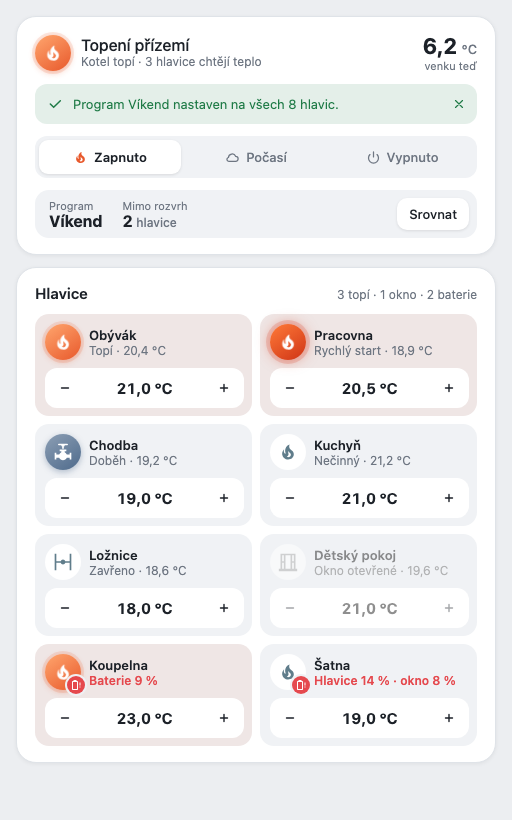
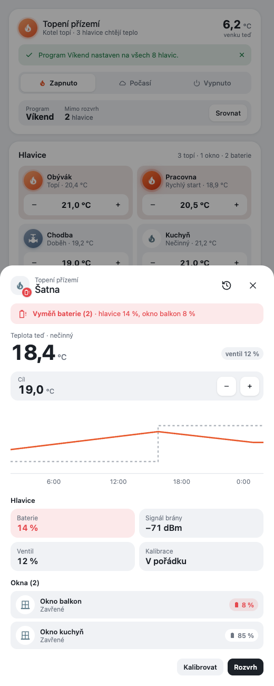
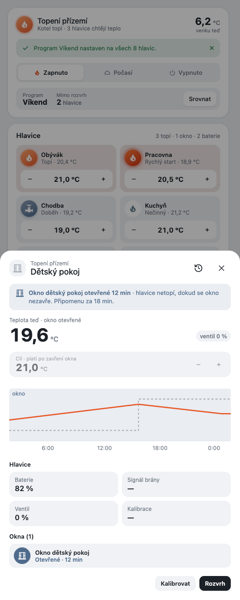
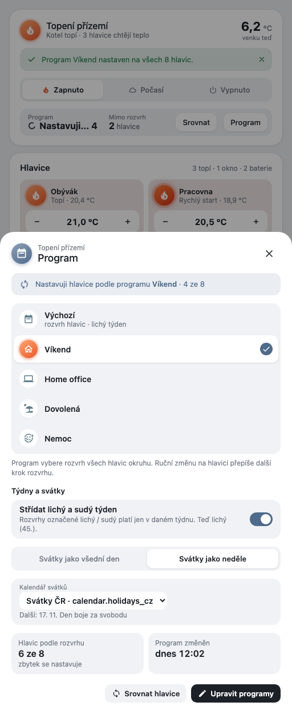
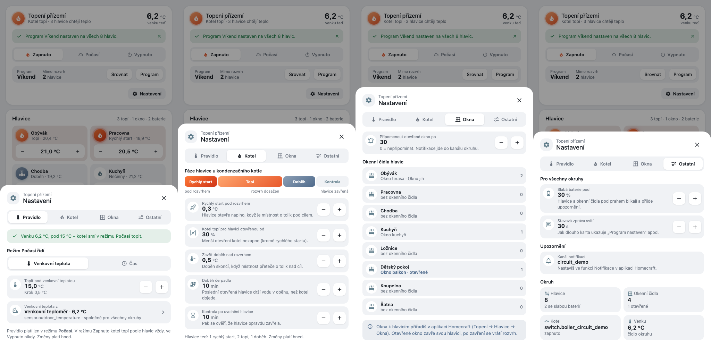
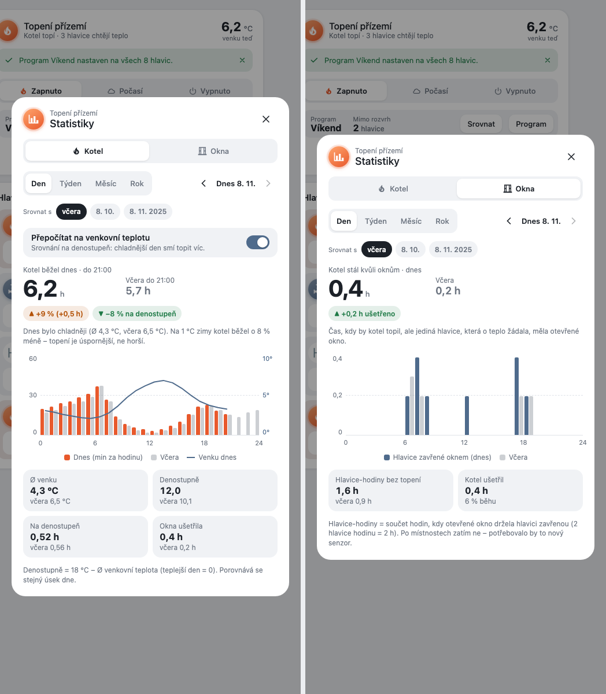

**English** · [Čeština](README.cs.md)

# Heating Card

A Home Assistant card for one heating circuit, in the Homecraft look: a circuit box (flame circle, outdoor temperature, status message, mode, program and valves off schedule) and a valves box (a tile per valve with its phase, state and − target +). It is the UI of the `homecraft` heating theme of [ha-features-builder](https://github.com/eMalinos/ha-features-builder) and reads only the entities that its `heating` feature publishes. Written in Czech.



## Installation

**HACS (custom repository):** HACS → ⋮ → Custom repositories → `https://github.com/eMalinos/heating-card`, type **Dashboard** → download **Heating Card** → reload the browser.

**Manual:** copy [`dist/heating-card.js`](dist/heating-card.js) to your Home Assistant `config/www/` folder and add it as a dashboard resource (Settings → Dashboards → ⋮ → Resources → URL `/local/heating-card.js?v=0.1.14`, type **JavaScript module**). Change `?v=` after copying a new version.

## Configuration

The ha-features-builder `heating` feature writes this config. By hand:

```yaml
type: custom:heating-card
circuit: heating_circuit_1        # the heating instance id
valves:                            # the circuit's valves
  - climate.living_room_valve
  - climate.bedroom_valve
heading: Topení přízemí            # optional; default: binary_sensor.heating_state_<circuit> attribute title, else the id
schedule_gesture: tap              # opens the schedule card for the valve
info_gesture: icon_tap             # opens the valve dialog
condensing_boiler: true            # false hides the Kotel tab of the settings dialog
```

`condensing_boiler` (boolean, default `true`; anything but `false` counts as `true`) says whether the circuit has a condensing boiler; without one the settings dialog has no *Kotel* tab.

Gestures are `tap`, `double_tap`, `hold`, `icon_tap`, `icon_double_tap`, `icon_hold` or `none` (the same values as the heating parameters); the two must differ unless both are `none`.

Entities read (`<c>` is the circuit): `switch.boiler_<c>`, `input_select.heating_mode_<c>`, `input_select.heating_auto_rule_<c>`, `input_datetime.heating_time_from_<c>` / `_to_<c>`, `input_number.heating_weather_threshold_<c>`, `input_number.heating_target_step_<c>`, `input_select.heating_target_control_<c>`, `input_text.heating_status_<c>`, `sensor.heating_program_<c>`, `sensor.heating_applying_<c>`, `sensor.heating_schedule_<c>`, `input_boolean.heating_week_alternation_<c>`, `input_select.heating_holidays_<c>`, `input_text.heating_holiday_calendar_<c>`, every `calendar.*`, `select.heating_program_<c>`, `sensor.heating_off_schedule_<c>`, `sensor.heating_valves_<c>`, `sensor.heating_low_batteries_<c>`, `binary_sensor.heating_active_<c>`, `binary_sensor.heating_state_<c>`, `sensor.heating_outdoor_temperature_<c>` and each valve's `climate` entity.

The middle mode segment reads *Čas* (clock icon) instead of *Počasí* while the rule (`input_select.heating_auto_rule_<c>`) is `time`.

Actions: the mode segments call `input_select.select_option`, the cross on the status message clears `input_text.heating_status_<c>`, **Srovnat** presses `input_button.heating_sync_<c>`, − / + change a valve's target by the step in `input_number.heating_target_step_<c>` (settings › Ostatní › Krok cíle hlavice; 0.5 °C without it; not on a valve with an open window or while the circuit is off). The **Statistiky** button opens the statistics dialog; `schedule_gesture` opens `heating-schedule-card` in a simple dialog.

### Parts of a circuit

When the circuit is split into parts (HFB heating 1.16 with `use_parts`, e.g. one boiler for two flats), the valve tiles are grouped per part under its name, read from `sensor.heating_parts_<c>`; valves in no part come last under *Ostatní*. Without that sensor the box looks as before. No card option is needed.

## Valve dialog

`info_gesture` opens the valve dialog (a bottom sheet under 600 px): the valve's icon circle (blinking battery badge when a battery is low), one alert under the header (the open window with minutes open and the reminder, else every low battery of the valve), the current temperature, the target stepper (disabled with an open window or while the circuit is off) and, when `input_select.heating_target_control_<c>` (settings › Ostatní › Ovladač cíle) is `arc`, `ruler` or `track`, a slider under it (drag; arrow keys step; one `set_temperature` on release; colours fixed to the temperature: 5 °C deep navy, 9 blue, 12 light blue, 17 amber, 21 orange, 25 red, 30 deep crimson), a 24 h chart of the room and target temperature (°C axis on the left) over a window of 24 h that can be moved back up to 7 days (drag it sideways by whole hours, ‹ › by 6 h, *Teď* back to now; midnight is labelled with the date) with the open-window spans as tinted bands and the valve's fast starts / overruns (`phases` of `sensor.heating_valves_<c>`) as strips on the bottom, with a legend, the *Hlavice* tiles (battery, signal in words — Silný ≥ −70 dBm, OK ≥ −85, Slabý below (amber, no blinking) — with the dBm, valve position, calibration; the battery tile turns red and blinks when low), one row per window sensor (*Okna*) with its state and its own battery, and the footer: **Kalibrovat** (after a confirm, runs `script.heating_calibrate_<c>` with `climate`) and **Rozvrh** (the schedule dialog). The header's history button opens the valve's more-info. A window sensor that is `unavailable` / `unknown` shows *Čidlo nedostupné*, never *Zavřené*.

Device facts (battery, signal, valve position, calibration) are found on the valve's device by device class / entity id suffix, like the Mushroom detail does; windows come from the `windows` attribute of `sensor.heating_off_schedule_<c>`; the reminder from `input_number.heating_window_reminder_<c>`; the low-battery threshold from `input_number.heating_low_battery_threshold` (30 % by default). The chart reads the history over `history/history_during_period`; without history the dialog shows a note instead.

 

## Program dialog

The **Program** button in box 1 opens the program dialog (a bottom sheet under 600 px): the circuit's programs as a radio list (tap = switch right away through `select.heating_program_<c>`; the current one is raised with a check), one alert while Node-RED applies the program or a sync (`Nastavuji hlavice podle programu … · 4 ze 7`), the *Týdny a svátky* section (week alternation switch = `input_boolean.heating_week_alternation_<c>`, *Svátky jako všední den / neděle* = `input_select.heating_holidays_<c>`, and with *neděle* a calendar select writing `input_text.heating_holiday_calendar_<c>` plus the next holiday), tiles *Hlavic podle rozvrhu* and *Program změněn*, and the footer: **Srovnat hlavice** and **Upravit programy** (opens the schedule dialog, where programs are edited). Names come from `program_names` of `sensor.heating_program_<c>`; the program options from `select.heating_program_<c>`; week and next holiday from `sensor.heating_schedule_<c>`. A missing helper hides its row.



## Settings dialog

The **Nastavení** button in box 1 opens the settings dialog (a bottom sheet under 600 px) with four tabs, each setting a soft panel with an icon circle, label, value and − / + (or a native picker). Changes apply immediately, there is no Save; quick taps on − / + add up until Home Assistant reports the value.

- **Pravidlo**: what rules the *Počasí* mode. One alert says what the rule decides now (`sensor.heating_weather_ok_<c>`). *Venkovní teplota* = `input_number.heating_weather_threshold_<c>` plus a picker of the outdoor source (`input_text.heating_outdoor_temperature_source`, shared by all circuits; every `sensor.*` with device class temperature and every `weather.*`); *Čas* = two time pickers (`input_datetime.heating_time_from_<c>` / `_to_<c>`). The rule itself is `input_select.heating_auto_rule_<c>`.
- **Kotel** (only with `condensing_boiler`): the phase strip (rychlý start, topí, doběh, kontrola) and `heating_fast_start_delta_<c>`, `heating_bypass_threshold_<c>`, `heating_close_margin_<c>`, `heating_bypass_overrun_<c>`, `heating_release_check_<c>`, plus how many valves are in which phase now (`sensor.heating_valves_<c>`).
- **Okna**: `heating_window_reminder_<c>` and, read only, the window sensors of each valve (assigned in the Homecraft app).
- **Ostatní**: `input_number.heating_low_battery_threshold` and `input_number.heating_status_duration` (shared), the notification channel (the circuit id, set in the app) and tiles for valves, window sensors, boiler relay and outdoor temperature.

The min, max, step and unit of every number come from its `input_number`. A missing helper hides its field. An open select or time picker is not rebuilt by a hass update; the update lands when it closes.



## Statistics dialog

The dark **Statistiky** button in box 1 opens the statistics dialog (a bottom sheet under 600 px) with two metrics:

- **Kotel**: how long the boiler ran, next to the same part of a comparison period. Hero number in hours, delta chips (`▲ +15 % (+0,8 h)`), paired bars (minutes per hour for a day, hours per day / month for a week / month / year) and the outdoor temperature as a line on a right axis, tiles *Ø venku*, *Denostupně*, *Na denostupeň* and *Okna ušetřila*. The switch **Přepočítat na venkovní teplotu** (on by default, kept while the card lives) adds a second chip and a sentence that compares the boiler time per degree day.
- **Okna**: the boiler hours saved by open windows (hero), valve-hours the windows kept closed (bars, tile) and the share of the boiler's run.

Period **Den / Týden / Měsíc / Rok** with ◀ ▶ (▶ is disabled on the current period; a week starts on Monday), one comparison chip at a time: day = *včera* / same day last month / same date last year, week = *minulý týden* / the same ISO week last year, month = last month / same month last year, year = last year. Comparisons are like-for-like: the comparison is cut at the same weekday / time as the current data reaches (a whole past period compares whole).

It reads only the long-term statistics through `recorder/statistics_during_period` (any user may call it), one call for the current range and one for the comparison, cached while the dialog is open (the current period is refreshed every 5 minutes):

| Statistic | Used for |
|---|---|
| `sensor.heating_stats_boiler_total_<c>` (`change`, hours) | boiler run time |
| `sensor.heating_stats_window_boiler_total_<c>` (`change`, hours) | boiler hours saved by windows |
| `sensor.heating_stats_window_valves_total_<c>` (`change`, hours) | valve-hours held closed by windows |
| `sensor.heating_outdoor_temperature_<c>` (`mean`, °C) | outdoor mean and degree days |

Statistics rows are hourly for a day and a week, daily for a month, monthly for a year. **Degree days** = Σ max(0, 18 °C − mean outdoor temperature) × the row's length in days (a warmer-than-18 °C row counts 0), so the boiler time per degree day is `h / degree days`. A failing call shows *Statistiky nejsou k dispozici.*, a new install without statistics shows an empty-state line.



## Look

Colours, radii and shadows come from the `--hfb-*` tokens of the [Homecraft style](https://github.com/eMalinos/ha-features-builder/blob/main/docs/style-homecraft.md), each with a Home Assistant theme fallback, so the card follows any theme. The card surface honours `--ha-card-background`, `--ha-card-box-shadow` and `--ha-card-border-radius`. Flame flicker and the low-battery blink stop with the system's reduce-motion setting.

## Tests

```sh
node --test tests/*.test.mjs                      # pure logic: config, valveView, circuitView, valveDetail, chartModel, programView, settingsView, statistics (periods, degree days, bars)
python3 -m http.server 8766 &
"Google Chrome" --headless=new --virtual-time-budget=30000 --dump-dom http://localhost:8766/tests/dom.html | grep RESULT   # prints RESULT OK
```

`tests/dom.html` renders the card with a fake `hass` built from `tests/fixtures/states.json` (real entity shapes from the dev HA, `circuit_demo`). Looks: `?theme=homecraft`, `?theme=dark`, none (HA fallbacks); add `&shot=1` for a screenshot and `&vd=dress` / `&vd=kids` to open the valve dialog (battery / open-window board).

## Changelog

- **0.1.14** — valve dialog: the valve name ends with its circuit part, `Obývák (Babi)` (HFB heating `use_parts`)
- **0.1.13** — valve chart: labels every 0.5 °C up to a 4 °C span (whole degrees above), helper lines at the quarters more visible, the chart a bit taller so the labels breathe
- **0.1.12** — valve chart: a tighter °C scale (0.2 °C around the room and the target, rounded to half a degree), labels every 0.5 / 1 °C by the span and unlabelled helper lines between them
- **0.1.11** — valve chart: the phases (rychlý start, doběh, zavřeno) are tinted bands across the whole chart instead of a lane under it; dialogs scroll without a visible scrollbar
- **0.1.10** — valve chart: the recorder keeps no `min_temp` / `max_temp` in the history, so the forced targets (30 °C fast start / run, 5 °C window / closed) were not recognised and stretched the scale to 30; the limits now come from the valve's state. The valve's phases (rychlý start, doběh, zavřeno) show as a lane under the time axis
- **0.1.9** — dialogs scroll with a thin rounded thumb in a soft text colour instead of the system scrollbar
- **0.1.8** — valve dialog chart: only the room temperature and the ordinary target set the °C scale; the 5 °C a window / closed valve is held at (also on a 4 °C valve) stays off it like max, and the right fast-start axis is gone
- **0.1.7** — valve tiles grouped per part of the circuit under the part's name, part-less ones under *Ostatní* (`sensor.heating_parts_<c>`, HFB heating 1.16 `use_parts`); a circuit without parts looks as before
- **0.1.6** — valve dialog target controls as design v8: one box with the target in it (arc: Cíl, big target, °C · teď in the middle, − krok + below; ruler: big target in its temperature colour on top, − teď · krok + below; track: Cíl + target with − / + on top), the target row hides; chart: the °C axis comes from the room and the ordinary target only, fast start's target is drawn on a right axis over the valve's range; settings › Ostatní: *Název hlavice na dlaždici* (beside / under the icon, `input_select.heating_tile_layout_<c>`, heating 1.15.0-beta.3)
- **0.1.5** — valve tiles: three a row from a ~470 px card (tile minimum 136 px instead of 160 px); names and states wrap instead of being cut off, the temperature keeps its °C, the − / + row sits at the tile's bottom
- **0.1.4** — valve dialog: no overrun in the chart; the arc / ruler / track slider sits on a tile background and replaces the − / + (only *Tlačítka* keep them); settings: the target control picker shows a small picture of each control, the boiler tile shows its friendly name, every boiler setting shows *Vypnuto* at its off value (bypass threshold 0, close margin below 0, overrun 0, release check 0; close margin below 0 needs heating 1.15.0-beta.2)
- **0.1.3** — valve dialog chart: dragging it shows real history (it holds 24 h before and after the shown day, the °C axis stays put); a target at the valve's max / min (fast start, overrun, open window, off) is left out of the target line and the °C scale, the strips show those spans.
- **0.1.2** — valve dialog: chart with a °C axis and fast-start / overrun strips; valve position only once (tile); signal in words; ± step from `input_number.heating_target_step_<c>` (settings › Ostatní, 0.5 °C without it); valve tiles fill the card in columns of at least 160 px; mode segment *Čas* under the time rule; target slider (Oblouk / Pravítko / Dráha) picked in settings › Ostatní; the chart can be dragged back in time (up to 7 days); settings Kotel: the phase strip dims *Rychlý start* while fast start is off.
- **0.1.1** — settings that are switched off show *Vypnuto*, dimmed: fast start below 0 (one − step from 0,0; needs HFB heating 1.14.0-beta.3, whose helper goes down to −0,1), pump overrun 0 min, window reminder 0 min.
- **0.1.0** — first release: circuit + valves boxes, valve, program, settings and statistics dialogs (Homecraft look, design rows v4–v7). Used by the HFB heating UI theme `homecraft`.
- **0.1.0-beta.6** — statistics dialog (box 1 *Statistiky* button): Kotel (run time, degree-day normalisation, outdoor line) and Okna (boiler hours saved), Den / Týden / Měsíc / Rok with navigation and one comparison; fix: reopening the schedule dialog right after closing it no longer loses its content.
- **0.1.0-beta.5** — settings dialog (box 1 *Nastavení* button): tabs Pravidlo / Kotel / Okna / Ostatní, immediate changes; new option `condensing_boiler` (default `true`; `false` hides the Kotel tab).
- **0.1.0-beta.4** — program dialog (box 1 *Program* button): program list, applying progress, week alternation, holidays and calendar, *Srovnat hlavice* / *Upravit programy*; generic dialog frame for the settings and statistics dialogs.
- **0.1.0-beta.3** — tiles, soft panels and window rows read `--hfb-tile-bg` / `-border` / `-shadow` / `-radius`, so they follow Bento's inner tile style.
- **0.1.0-beta.2** — valve dialog (batteries, windows, 24 h chart, calibrate); `info_gesture` opens it instead of more-info.
- **0.1.0-beta.1** — circuit and valves boxes.

## License

MIT
